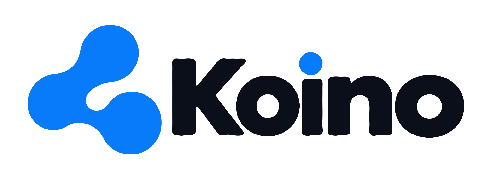

# Identidade visual da Koino

A identidade aprovada usa o símbolo orgânico azul e a marca nominativa Koino. Preserve a arte, as proporções, o ponto azul sobre o “i” e o espaço de respiro.

## Arquivos disponíveis neste repositório

| Aplicação | Arquivo |
| --- | --- |
| Logo sobre fundo claro | [SVG](../assets/brand/Koino_Logo_Transparente.svg) · [PNG](../assets/brand/Koino_Logo_Transparente.png) |
| Logo sobre fundo escuro | [SVG](../assets/brand/Koino_Logo_Fundo_Escuro.svg) · [PNG](../assets/brand/Koino_Logo_Fundo_Escuro.png) |
| Símbolo isolado | [SVG](../assets/brand/Koino_Simbolo_Transparente.svg) · [PNG](../assets/brand/Koino_Simbolo_Transparente.png) |
| Avatar | [SVG](../assets/brand/Koino_Perfil_Instagram_1080.svg) · [PNG](../assets/brand/Koino_Perfil_Instagram_1080.png) |
| Paleta | [CSS](../assets/brand/Koino_Cores.css) · [JSON](../assets/brand/Koino_Cores.json) · [SVG](../assets/brand/Koino_Paleta.svg) |

## Cores de referência

- Azul principal: `#087BFA`
- Preto profundo: `#0B0F1A`
- Azul claro: `#E6F2FF`
- Branco: `#FFFFFF`

As cores são referências aproximadas da direção aprovada. Poppins e Inter podem ser usadas em textos de apoio; **não substituir a tipografia da logo**.

**Nota técnica:** os SVGs foram reconstruídos a partir de referência raster aprovada. Não são os vetores de origem. Os PNGs e os cinco slides aprovados também foram transferidos para este repositório.

## Apresentações

A narrativa de cinco slides aprovada em 18/10/2026 serve como referência. Cada slide apresenta apenas uma ideia, com títulos expressivos, fotos humanas e espaço em branco. Evitar cards densos, rodapés, paginação decorativa ou reutilizar a identidade anterior Engrena Tech.
